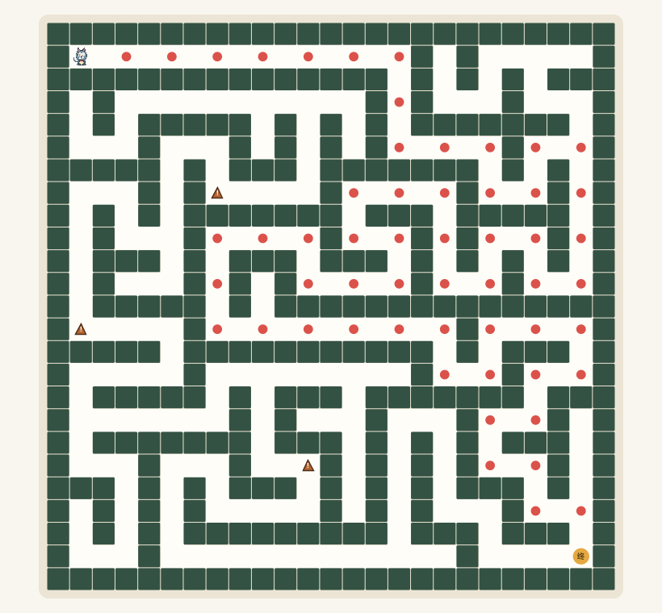

# 猫宁迷宫 · Java 寻路游戏

一个可离线运行的 Java Swing 迷宫小游戏，用于复现软件开发见习中接触过的迷宫游戏练习。




## 功能

- 使用 DFS 回溯算法生成迷宫布局，每关逐步扩大
- 共 10 个难度递进的关卡
- 陷阱数量从第 1 关的 1 个增加到第 10 关的 10 个
- 踩中陷阱会回到起点
- 每关限时 120 秒，顶部显示倒计时
- 倒计时结束后停止移动，可重新挑战本关
- 方向键或 WASD 控制角色移动：W/↑ 向上、S/↓ 向下、A/← 向左、D/→ 向右
- 检查角色所在格与目标格之间的墙体，无法穿墙
- 到达终点自动判定通关
- 到达终点显示“恭喜你通关啦！”
- 每关通关时显示本关移动步数和实际用时
- 使用 BFS 广度优先搜索显示醒目的红色最短路径提示；再次点击可关闭
- 使用原创灰蓝猫动画角色，带移动方向和轻微起伏动画
- 按 `H` 切换路径提示，按 `R` 重走本关

## 运行

Windows 可双击：

```text
启动迷宫游戏.cmd
```

也可以在命令行构建并运行：

```text
build.cmd
java -jar build\MazeGame.jar
```

需要 JDK 17 或更高版本。

## 项目结构

```text
src/main/java/com/zhengli/maze/MazeModel.java
src/main/java/com/zhengli/maze/MazePanel.java
src/main/java/com/zhengli/maze/MazeGame.java
src/test/java/com/zhengli/maze/MazeModelTest.java
```

## 算法说明

迷宫主体使用深度优先搜索加回溯生成，保证任意两个通路单元之间存在可达路径。

路径提示使用 BFS：

1. 从玩家当前位置开始入队；
2. 依次访问上下左右可通行单元；
3. 记录每个单元的父节点；
4. 到达出口后反向还原路径。

BFS 在无权网格中能够找到最少步数路径。

## 简历表述

```text
迷宫寻路游戏｜个人复现项目｜Java / Swing
- 使用 DFS 回溯算法生成迷宫布局，完成角色移动、墙体碰撞和通关判定。
- 使用 BFS 计算并可视化玩家到终点的最短路径，实时统计步数和通关时间。
- 设计 Swing 图形界面和键盘交互，并编写算法测试验证迷宫连通性与路径正确性。
```

该项目属于个人复现，不描述为东软正式上线项目。

## 说明

角色为本项目原创的经典动画风灰蓝猫精灵，不使用官方动画角色原图。
